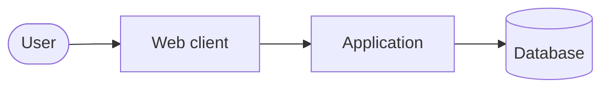

# <Product name> — Architecture

<!--
Guidance:
- Read the APPROVED PRD, design brief and UI spec first. Size this document to the project; omit sections that don't apply
  and say so in one line instead of padding.
- Default to a modular monolith unless the requirements give a concrete reason not to.
- Recommend ONE architecture. Alternatives get a short trade-off note and an ADR when significant.
- Every significant decision → docs/architecture/adr/ADR-###-<slug>.md.
-->

## 1. Context and drivers

| Driver | Source (FR/NFR/UX) | Architectural consequence |
|---|---|---|

## 2. System overview

## 3. Components and boundaries

| Module | Responsibility | Owns data | Depends on | Must not depend on |
|---|---|---|---|---|

## 4. Key data flows

## 5. Frontend architecture

<!-- Routing, state, data fetching, how tokens.json is consumed, component library policy. -->

## 6. Backend architecture

<!-- Layers/modules, transaction boundaries, validation, error model. -->

## 7. API and contracts

<!-- Link docs/api/openapi.yaml if an HTTP API exists. State its info.version. -->

## 8. Authentication and authorisation

## 9. Security and privacy

## 10. Testing strategy

| Level | Tooling | What it proves | Runs in |
|---|---|---|---|

## 11. Errors, observability and operations

## 12. Deployment, environments and rollback

## 13. Risks and open questions

## 14. Decision index

| ADR | Title | Status |
|---|---|---|

## 15. Change log

| Version | Date | Change | Decided by |
|---|---|---|---|
| 0.1.0 | | Initial draft | |
