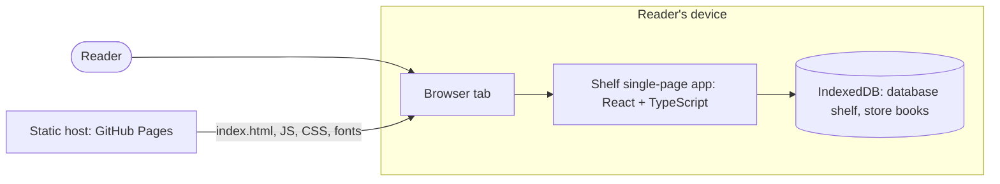

# Shelf — Architecture

Shelf is a single-page app that runs entirely in the reader's browser. Static files come from a static host. The books live in the browser's IndexedDB on the reader's device, and nothing is sent back. The owner chose this stack on 2026-10-29 (ADR-001).

This document is written against [PRD](../product/prd.md) v1.1.0, [DESIGN-BRIEF](../design/design-brief.md) v1.0.1, [UI-SPEC](../design/ui-spec.md) v1.1.0 and [TOKENS](../design/tokens.json) v1.0.0. The [data model](data-model.md) and the [implementation guidelines](implementation-guidelines.md) are derived from it. The walking skeleton in [`app/`](../../app/package.json) proves the toolchain; it implements no product feature.

## 1. Context and drivers

| Driver | Source (FR/NFR/UX) | Architectural consequence |
|---|---|---|
| The library belongs to one browser on one device; there is no sync. | A1, FR-006, NFR-004 | The data stays in the browser (IndexedDB). There is no server, account or identifier (ADR-001, ADR-002). |
| No sign-in, no personal data, no analytics or third-party content. | NFR-004, A11 | There is no backend and no HTTP API. Every file comes from Shelf's own origin, under a Content-Security-Policy that allows only `'self'` (ADR-006), and the font is self-hosted (ADR-005). |
| Changes survive reloads and later visits, and a failed save is reported. | FR-006 AC-1 to AC-3, UX-107 | A write reports success only after its IndexedDB transaction completes. The storage port returns typed failures (section 7). |
| Reading the stored library can fail too. | FR-006 AC-4, UX-006 | The storage port reports read failures. The shell's `unreadable` state shows UX-006 in place of any page and never the empty library, and "Try again" reads again (section 4). |
| Title order ignoring case, with ties in the order the books were added. | FR-001 AC-2, AC-3 | Books are sorted in memory with an English collator. Ties are broken by the auto-increment key (DATA-MODEL §2). |
| Each page is its own history entry, Edit and Delete pages can be reloaded, and the library replaces a submitted page in the history. | UI-SPEC §1, UX-003, UX-004, UX-005 | Query-string routes on the History API, served by one static `index.html` (ADR-003). |
| Exact focus and scroll rules F1 to F15, with no live regions. | UI-SPEC §2, NFR-001 | The app shell owns a one-shot focus-intent mechanism (section 5.5). |
| Every visual value is a token, and light and dark follow the device. | UI-SPEC §2, TOKENS | A build script turns `tokens.json` into CSS custom properties. Component CSS contains no raw values (ADR-004). |
| Literata, self-hosted, with the weight and optical-size axes. | DESIGN-BRIEF §6, UI-SPEC D5 and TQ-1 | Fontsource's Literata files are bundled and served from Shelf's origin (ADR-005). |
| 500 books, with every entry in the document. | NFR-003, UI-SPEC §2 | One `getAll()` at start-up and one plain list: no pagination and no virtualisation. |
| Phone and desktop browsers, current stable versions, down to 320px wide. | NFR-002, A8 | Vite's default production target, no polyfills, and responsive CSS driven by tokens. |
| WCAG 2.2 AA. | NFR-001 | Native controls only. Automated checks run in component tests and in a real browser, and manual walkthroughs happen before each release (section 10). |
| A tiny pilot that moves quickly through every stage. | PRD C1 | A modular single-page app with five source modules. The only runtime dependencies are React and the font files. |

## 2. System overview



There is no server-side code. The host serves the built files over HTTPS; the app reads and writes only the browser's IndexedDB for Shelf's origin. No request ever carries book data.

## 3. Components and boundaries

Paths are relative to `app/`. The rules in the last two columns are enforced by oxlint ([`.oxlintrc.json`](../../app/.oxlintrc.json), GUIDELINES §3).

| Module | Responsibility | Owns data | Depends on | Must not depend on |
|---|---|---|---|---|
| `src/books/` | Domain: the `Book` type, reading statuses and their labels, trimming and validation (FR-003 rules), library order (FR-001) | None (pure functions) | Nothing | React, `src/storage`, `src/app`, `src/pages`, `src/components` |
| `src/storage/` | The `BookRepository` port and its IndexedDB adapter. It maps IndexedDB errors to `StorageError` (section 7). | The IndexedDB database `shelf` | `src/books` | React, `src/app`, `src/pages`, `src/components`; network APIs |
| `src/app/` | App shell: the start-up read, library state in memory, routes and navigation, focus intents and scroll memory, document titles. It calls the repository and passes data and callbacks to pages. | Library state (memory); the current route (URL) | `src/books`, `src/storage`, `src/pages`, `src/components` | Network APIs; `localStorage`, `sessionStorage` |
| `src/pages/` | One component per page: UX-001/UX-002, UX-003, UX-004, UX-005 and the read-failure page UX-006. Each owns its form state and messages. | Form state while open | `src/books`, `src/components` | `src/app`, `src/storage` |
| `src/components/` | Presentational components UX-101 to UX-107 | None | `src/books` (types, labels) | `src/app`, `src/pages`, `src/storage` |
| `src/styles/` | `tokens.css` (generated), `fonts.css`, `base.css` (reset, focus ring, visually hidden text) | None | Generated from `docs/design/tokens.json` | — |
| `src/qa/` (QA builds only) | Visual-QA fixtures: seed the sample library, make writes fail (section 10) | None | `src/storage`, `src/books` | Production builds (excluded at build time) |
| `scripts/` | Build-time Node scripts: tokens to CSS, CSS literal check (ADR-004) | None | `docs/design/tokens.json` | App source |

`src/main.tsx` is the composition root: it creates the IndexedDB repository, imports the global styles and renders the app shell.

## 4. Key data flows

**Start-up (FR-001, FR-006 AC-1, UX-001 Loading, F1).**

1. The browser loads `index.html` and the bundle, and the app shell parses the route from the URL (ADR-003).
2. The shell renders the page frame with the masthead only (the Loading state) and calls `listBooks()`.
3. On success, it keeps the books in memory, ordered by `sortLibrary` (DATA-MODEL §2), and renders the requested page.
   - An Edit or Delete route for a missing book is replaced by the library (F14).
   - Focus is not moved (F1).
4. On failure, the shell enters the `unreadable` state. It renders UX-006 in place of the requested page and never UX-002 for it (FR-006 AC-4). The URL is left as it is.
   - "Try again" calls `listBooks()` again, without a reload. After a failed open the adapter holds no connection, so the call opens the database afresh (section 7, rule 4). The state stays `unreadable` while the read runs, so UX-006 stays on screen, and a second activation is ignored (UI-SPEC D14).
   - On success the shell continues from step 3 for the same route, and focuses that page's `h1` instead of applying F1. On failure UX-006 stays and its `h1` is focused (F15).
   - While `unreadable`, `popstate` renders UX-006 again for the new URL (UI-SPEC §1), and a reload starts again at step 1.

**Add (FR-003, FR-006 AC-2, AC-3).**

1. The page trims and validates the details with `src/books`. If they're invalid, it shows the field errors and focuses the first failing field (F5).
2. If they're valid, the page calls `onSave(details)`, and the shell calls `addBook`.
3. The repository resolves after the transaction's `complete` event.
4. On success, the shell adds the stored book to memory, replaces the history entry with the library, and focuses the new entry (F7).
5. On failure, memory is unchanged. The page shows UX-107 and focuses it (F6).
6. A second activation while a save is in flight is ignored.

**Edit (FR-004).** The flow is the same as Add, with `updateBook(id, details)`. The update reads and writes the record in one transaction. If the book is gone (Q9, two tabs), it returns `null` instead of re-creating it, and the shell replaces the route with the library (F14).

**Delete (FR-005, FR-002 AC-3).** "Delete book" calls `deleteBook(id)`. When it commits, the book leaves memory, the library replaces the page in the history, and focus moves to the next entry (F8), or to the empty library's `h1` (F9). Reaching UX-005 changes nothing.

**Cancel, wordmark and Back (F10 to F12).**

- If the page was opened from the library in this tab, Cancel and the wordmark call `history.back()`.
- Otherwise, for example after a reload or a pasted URL, they replace the entry with the library.
- Either way, the library restores its remembered scroll position and focuses the control that opened the page.

## 5. Frontend architecture

### 5.1 Rendering and state

- **Rendering:** React 19 renders on the client, in `StrictMode`. There is no server rendering: the host is static (ADR-006).
- **Library state:** one reducer in the app shell holds `loading`, `ready` (with the books) or `unreadable` (with the `StorageError`). It changes only after a repository call resolves, so the screen never shows a change as saved before it is stored (FR-006 AC-3).
- **Page state:** pages are controlled by props. They receive the book or books, `onSave`/`onDelete` callbacks that resolve to `{ ok: true }` or `{ ok: false }`, and link targets. Form values, field errors and the save-failure flag are local state.
- **No libraries:** there is no global state library and no data-fetching library. There is nothing to fetch.
- **Two tabs (PRD Q9):** behaviour stays undefined. Each tab keeps its own copy in memory. The repository closes its connection on `versionchange`, so a newer tab's upgrade isn't blocked (DATA-MODEL §5).

### 5.2 Routing

Routing uses query-string routes on the History API, with no router library (ADR-003). The URL scheme is the implementation freedom that UI-SPEC §1 left to this stage.

| Page | URL, relative to the app's base | Notes |
|---|---|---|
| UX-001 / UX-002 Library | `./` (no `page` parameter) | UX-002 when there are no books |
| UX-003 Add a book | `./?page=add` | |
| UX-004 Edit book | `./?page=edit&book=<id>` | `<id>` is the book's key, a positive integer (DATA-MODEL §2) |
| UX-005 Delete confirmation | `./?page=delete&book=<id>` | |

- **History:** opening Add, Edit or Delete from the library calls `pushState`, so each page is its own entry. A successful save or delete calls `replaceState` to the library. `popstate` re-renders from the URL.
- **Unknown routes:** an unknown `page`, a missing or malformed `book`, or a book that doesn't exist leads to a `replaceState` to the library, with F14 focus. Other parameters are ignored; `capture-previews.mjs` appends `theme`.
- **Links:** links keep real `href`s, so opening them in a new tab works. Click handlers intercept only unmodified primary clicks.
- **Scroll and title:** `history.scrollRestoration` is `manual`; the shell restores scroll itself (5.5). The shell sets `document.title` from the page's `h1`, as UI-SPEC §1 specifies.
- **Base path:** Vite builds with `base: './'`. The same build then works on the GitHub Pages project path, under `vite preview` and under `capture-previews.mjs`.

### 5.3 Styling and design tokens

Tokens become CSS custom properties through a build script (ADR-004).

- **Generation:** `app/scripts/build-tokens.mjs` reads `docs/design/tokens.json` and writes `app/src/styles/tokens.css`.
  - Aliases are resolved.
  - `theme.light.*` becomes `--color-*` on `:root`, and `theme.dark.*` redefines the same names under `@media (prefers-color-scheme: dark)`, with the matching `color-scheme`.
  - Responsive `.narrow`/`.wide` pairs become one property, redefined under `@media (min-width: 48rem)` (`layout.breakpoint`).
  - `color.palette.*` is not emitted, so components can use colours only through theme roles.
  - The file is committed. `--check` mode fails when it is stale; the lint script runs it.
- **Component CSS:** each component has a CSS Module (`*.module.css`) that uses only `var(--…)` values.
  - `base.css` holds the reset, the `:focus-visible` outline (`--focus-*`) and the visually-hidden utility.
  - A dependency-free check (`app/scripts/check-css.mjs`) rejects colour literals and px/rem/em lengths outside `tokens.css`. Its allow-list covers `0`, percentages, `fr`, `auto`, and the one breakpoint literal `48rem`.
  - There are no inline styles and no CSS-in-JS.
- **Dark theme:** follows `prefers-color-scheme` only, with no switch and no stored preference (UI-SPEC §2).

### 5.4 Typography

Literata is self-hosted from `@fontsource-variable/literata` (ADR-005, resolving TQ-1 as its default proposed).

- **Declarations:** `src/styles/fonts.css` declares family `Literata`, normal and italic, weights 200–900, with the optical-size axis. It takes the package's `opsz` WOFF2 files, one `@font-face` per Unicode subset with that subset's `unicode-range`, and sets `font-display: swap`.
- **Optical sizing:** the body sets `font-optical-sizing: auto`.
- **Cost:** for an English library the browser downloads only the Latin files: 110,080 bytes (normal) and 113,180 bytes (italic). Other subsets load only when a title uses their characters.
- **Licence:** the SIL Open Font License text ships with the build.

### 5.5 Focus and scroll (F1 to F15)

**Mechanism.** Before a navigation, the shell records a **focus intent**.

- The intent is kept in memory only: never in the URL or in `history.state`. A reload therefore falls back to F1.
- The page that renders next consumes the intent once, in a layout effect, after its content is in the document. The intent is then cleared.
- Programmatic targets (`h1`, library entries, the save-failure message, `main`) have `tabIndex={-1}`, and `base.css` gives them no outline.
- Scrolling is immediate: `scroll-behavior: auto`, and never `behavior: 'smooth'`.

| Rule | Recorded by | Target | Scroll |
|---|---|---|---|
| F1 | Nothing: no intent exists at load | None | Browser default |
| F2–F4 | Shell, when it opens UX-003/004/005 | The new page's `h1` | `scrollTo(0, 0)`, then `focus({ preventScroll: true })` |
| F5 | Page, after failed validation | First invalid field: Title, then Author | `focus()` brings it into view |
| F6 | Page, after a failed store | The UX-107 message | `focus()` |
| F7 | Shell, after add or edit succeeded | Entry of the saved book id | `scrollIntoView({ block: 'nearest' })`, then focus without scrolling |
| F8 | Shell, after delete with books left | Entry now at the deleted index, or the last entry | As F7 |
| F9 | Shell, after deleting the only book | UX-002 `h1` | Top |
| F10, F11 | Shell, on Cancel or the wordmark | The opener: "Add a book", or that book's "Edit"/"Delete" link, derived from the page being left | Remembered library scroll position, then focus without scrolling |
| F12 | Shell, on `popstate` back to the library | As F10/F11 | As F10/F11 |
| F13 | Skip link click handler (default prevented, so the URL is unchanged) | `main` | `main` brought into view |
| F14 | Shell, during route resolution | The library's `h1` | Top |
| F15 | Shell, when the read after "Try again" resolves | Failed: UX-006's `h1`. Read: the `h1` of the page for the current route (F14's target for a missing book) | Top |

The library's scroll position is remembered in memory when the reader leaves the library for another page. After a reload there is none, and the library opens at the top.

### 5.6 Accessibility implementation

- **Markup:** native elements only, with `lang="en"` on the document.
- **Book text:** titles and authors get `dir="auto"`.
- **Hidden text:** the "Error: " and "Status: " prefixes and the hidden title suffixes on Edit/Delete use a shared visually-hidden class.
- **Forms:** `novalidate`, `aria-invalid` and `aria-describedby`, `required` on Title, and `autocomplete="off"`.
- **Radios (UX-106):** `appearance: none` with token-drawn rings, falling back to `appearance: auto` under `forced-colors: active`.
- **No live regions.** oxlint's jsx-a11y rules run in `npm run lint`.

### 5.7 Component library policy

None. UX-101 to UX-107 are Shelf's own components, built from native elements; no UI kit is added.

## 6. Backend architecture

Not applicable: Shelf has no server-side code (ADR-001).

## 7. API and contracts

There is no HTTP API, so there is no `docs/api/openapi.yaml`. The internal contract is the storage port, which the first storage issue creates in `app/src/storage/bookRepository.ts` exactly as below. The domain types move to `src/books/book.ts`, and the port re-exports them.

```ts
export type BookId = number // IndexedDB auto-increment key; also the creation order
export type ReadingStatus = 'want-to-read' | 'reading' | 'finished'

export interface Book {
  readonly id: BookId
  readonly title: string // trimmed, 1–200 characters (DATA-MODEL §2)
  readonly author: string // trimmed, 0–200 characters; '' means no author
  readonly status: ReadingStatus
}

/** Trimmed, validated details from the add or edit form (src/books). */
export interface BookDetails {
  readonly title: string
  readonly author: string
  readonly status: ReadingStatus
}

export type StorageErrorKind =
  | 'unavailable' // no IndexedDB, or storage blocked by settings or context (SecurityError, permission denied)
  | 'newer-version' // the stored database is newer than this build and lacks what it needs (VersionError)
  | 'blocked' // an upgrade still waits for another tab after 10 s (blocked event)
  | 'quota-exceeded' // writes only (QuotaExceededError)
  | 'failed' // anything else: UnknownError, NotReadableError, AbortError, InvalidStateError, a lost connection

export interface StorageError {
  readonly kind: StorageErrorKind
  readonly name: string // the DOMException name, for logs and tests; never shown to the reader
}

export type StorageResult<T> =
  | { readonly ok: true; readonly value: T }
  | { readonly ok: false; readonly error: StorageError }

export interface BookRepository {
  /** Every stored book in creation order (ascending id). A failure here is a read failure (FR-006 AC-4, UX-006). */
  listBooks(): Promise<StorageResult<readonly Book[]>>
  /** Stores a new book; resolves after the transaction commits. */
  addBook(details: BookDetails): Promise<StorageResult<Book>>
  /** Replaces a book's details; null when the book no longer exists. Never re-creates a deleted book. */
  updateBook(id: BookId, details: BookDetails): Promise<StorageResult<Book | null>>
  /** Removes a book; also succeeds when it is already gone. */
  deleteBook(id: BookId): Promise<StorageResult<void>>
}
```

Rules of the contract:

1. **Results as values.** Every method resolves and none rejects. Callers handle `ok: false`.
2. **Commit before success.** A write resolves with `ok: true` only after its transaction's `complete` event, so a reload straight afterwards shows the change (FR-006 AC-2). Write transactions request `durability: 'strict'`; browsers that don't support the option ignore it.
3. **Single-record writes.** Each write is one record in one transaction. Updates `get` and `put` in the same `readwrite` transaction.
4. **Connections.** The adapter opens the database on first use and reuses the connection. It closes the connection on `versionchange`. After a `close` event or an `InvalidStateError`, the next call opens a new connection. The adapter never retries a call itself, so a write can't be applied twice.
5. **Ordering.** `listBooks` returns creation order. FR-001 ordering is `sortLibrary` in `src/books`, not storage's job.
6. **Exclusive access.** No module other than `src/storage/` touches IndexedDB; lint enforces this.
7. **Error mapping.**
   - `unavailable`: a missing `indexedDB`, `SecurityError`, and any `UnknownError` or `InvalidStateError` raised while opening. Chromium reports blocked storage as an open failure with "The user denied permission to access the database.".
   - `newer-version`: `VersionError`, when the fallback open also fails (DATA-MODEL §5).
   - `quota-exceeded`: `QuotaExceededError`.
   - `failed`: everything else.
8. **Logging.** Failures are logged with `console.error` (operation and `name`), never with book details.

The contract changes only through a new ARCH version. The schema it stores is owned by DATA-MODEL.

## 8. Authentication and authorisation

Not applicable: there are no accounts and no sign-in (NFR-004). The browser's same-origin policy is the only isolation. The database belongs to Shelf's origin (see the shared-origin risk in section 13).

## 9. Security and privacy

**Threat model.** No server, no secrets, no accounts. The risks that remain:

- script injection through book text
- a compromised dependency
- accidental requests to third parties
- other sites on the same origin
- framing

**Controls:**

- **No third-party requests (NFR-004).**
  - The production `index.html` carries this policy as a `<meta http-equiv="Content-Security-Policy">`:
    `default-src 'none'; script-src 'self'; style-src 'self'; font-src 'self'; img-src 'self'; connect-src 'self'; base-uri 'none'; form-action 'none'; object-src 'none'`
  - A Vite plugin applied only to builds inserts the policy, because the dev server needs inline scripts and a WebSocket for hot reload.
  - `build.assetsInlineLimit: 0` keeps assets out of `data:` URIs.
  - `<meta name="referrer" content="no-referrer">` is added.
  - Lint bans `fetch`, `XMLHttpRequest`, `WebSocket` and `EventSource` in app code (ADR-006).
- **Header-only protections are not available.** GitHub Pages can't set response headers, and a `<meta>` policy can't carry `frame-ancestors` or reporting directives. Framing is an accepted, low risk: deleting a book takes two separate pages.
- **Injection.** React escapes text. `dangerouslySetInnerHTML` is banned by lint (`react/no-danger`), and no code writes `innerHTML`. Book text is never put into URLs, apart from the numeric book id.
- **Stored data.** IndexedDB holds book details only: no cookies, `localStorage`, identifiers or timestamps (DATA-MODEL §6). Text fields use `autocomplete="off"`. There is no analytics, telemetry or error-reporting service.
- **Supply chain.**
  - Exact versions, a committed lockfile and `npm ci` (GUIDELINES §8).
  - `ignore-scripts=true`: the skeleton's tree has no install scripts.
  - Versions at least 7 days old.
  - A licence check for each new package.
  - Only React, React DOM and the font files ship in the build.
- **The host.** GitHub Pages serves the files and, like any web host, records requests for them, including IP addresses, under GitHub's terms. Shelf adds nothing to those requests. Whether this satisfies NFR-004 and PRD Q10 is open question OQ-3.

**Verification:** the planned end-to-end suite runs J1 to J3. It fails if any request leaves Shelf's origin or a `securitypolicyviolation` event fires, and it checks that IndexedDB contains only the `books` store with the four book fields (NFR-004 verification).

## 10. Testing strategy

| Level | Tooling | What it proves | Runs in |
|---|---|---|---|
| Unit | Vitest 5 (verified) | `src/books`: trimming and validation (FR-003 AC-4 to AC-6, character counting), order (FR-001 AC-2, AC-3). Route parsing (ADR-003). Token mapping and the CSS check (ADR-004). | `npm test`, locally and in `app-check` |
| Storage | Vitest + fake-indexeddb (planned) | The `BookRepository` contract (section 7): commit before success, creation order, `null` for a missing book, error mapping with simulated failures, upgrades from every earlier schema version (DATA-MODEL §5) | `npm test` |
| Component | Vitest + Testing Library + jsdom (verified) + user-event (planned) | Pages UX-001 to UX-006 with a fake repository: states, exact copy, accessible names, keyboard paths, focus rules F2 to F11 and F13 to F15, and no double add | `npm test` |
| Accessibility, automated | axe-core in component tests (planned); `@axe-core/playwright` in the browser (planned) | NFR-001's automated part on every screen and state. jsdom covers structure, names and ARIA; the browser adds colour contrast and computed styles. | `npm test`, end-to-end suite |
| End-to-end | Playwright (planned): Chromium in CI, Firefox and WebKit locally before release | J1 to J3 in a real browser: persistence across reloads (FR-006 AC-1, AC-2), browser Back (F12), reloading Edit and Delete pages, 320px reflow (`scrollWidth` ≤ viewport), no request off-origin and no CSP violation (NFR-004), a 500-book library (NFR-003) | Planned `npm run test:e2e`; added to CI by its own issue |
| Visual QA | [`capture-previews.mjs`](../../.sdlc/scripts/capture-previews.mjs) `--url` against `vite preview` of a QA build; Playwright screenshots for states behind a form submission | UI-SPEC VACs: captures beside `previews/v1/` and `ui-states/` at desktop, mobile and 320×640, light and dark | Locally, in every UI issue before its PR; images go in the PR |
| Manual | Keyboard-only and screen-reader walkthroughs of J1 to J3 on one phone and one desktop browser | NFR-001, NFR-002 | Before each release (owner) |

**QA build (planned).**

- **Build:** `vite build --mode qa` includes `src/qa/`, which reads a `fixture` URL parameter:
  - `sample` seeds the 12 books of [content.md](../design/explorations/content.md) into an empty database.
  - `fail-writes` makes every write return `failed`, for the UX-107 states.
- **Exclusion from production:** production builds drop the module (`import.meta.env.MODE`). A unit test checks that the production bundle contains no sample title.
- **Capture constraints:**
  - `capture-previews.mjs` starts each run with a fresh browser profile and appends `?theme=` or `&theme=` to the URL. Query-string routes keep these as real navigations; hash routes failed this way (ADR-003).
  - It can't type or submit, so field-error and failed-save states are captured with Playwright at the same sizes and themes, with the same file names.
- **Example (planned):**
  `node .sdlc/scripts/capture-previews.mjs --url library="http://localhost:4173/?fixture=sample" --url add="http://localhost:4173/?page=add&fixture=sample" --out app/qa-captures --viewports desktop,mobile,320x640 --themes light,dark`

**Test names** cite IDs: `FR-001 AC-2: …`, `UX-003 F5: …` (GUIDELINES §6).

## 11. Errors, observability and operations

| Error | Detected by | Reader sees |
|---|---|---|
| Invalid details | `src/books` validation | Field messages (UX-105), focus F5 |
| Write failed | Repository `ok: false` | UX-107, focus F6. Memory and screen unchanged (FR-006 AC-3). |
| Read failed at start-up | `listBooks` `ok: false` | `unreadable` state: UX-006 in place of the requested page, never the empty library (FR-006 AC-4). "Try again" reads again, with focus F15. |
| Book no longer exists | Route resolution or `updateBook` returning `null` | The library, with F14 |
| Unexpected script error (a bug) | Not handled in v1 | Nothing specified (OQ-5); logged to the console |

- **Observability:** none beyond the browser console. NFR-004 rules out telemetry, so failures in the field are invisible to the owner. That is accepted.
- **Operations:** nothing runs server-side. After each release the owner runs J1 on the live site.

## 12. Deployment, environments and rollback

- **Environments:**
  - `npm run dev` (local, hot reload)
  - `npm run preview` (local production build)
  - the QA build (planned, local only)
  - production: a GitHub Pages project site, expected at `https://dariusghiura.github.io/sdlc-pilot-shelf/` (ADR-006)
- **Deploying (proposed, not part of this PR).** A later, owner-approved workflow, triggered only by `workflow_dispatch` from a release tag:
  - It runs `npm ci` and `npm run build` in `app/`, uploads `app/dist` with `actions/upload-pages-artifact`, and deploys with `actions/deploy-pages`.
  - It targets the `github-pages` environment, with the owner as required reviewer.
  - Enabling Pages and the environment are repository settings, which only the owner changes. Agents never trigger deployments (AGENTS.md §6).
- **Releases** are tags `vX.Y.Z` created by the owner. A release that changes the IndexedDB schema says so in its notes.
- **Rollback:** the owner re-runs the deploy for the previous tag. The schema is expand-only, and an older build opens a newer database when the stores it needs exist (DATA-MODEL §5), so rolling back never locks a reader out. A release that removes something from the schema is marked as a rollback barrier.

## 13. Risks and open questions

| Risk | Likelihood | Impact | Mitigation |
|---|---|---|---|
| Reading the library fails (blocked storage, a newer schema, platform errors). | Medium | High: the reader can't reach their books until a read succeeds | Reads report failures (section 7). The shell shows UX-006 with "Try again", never UX-002, and writes nothing meanwhile (FR-006 AC-4, settled by [change request #6](https://github.com/dariusghiura/sdlc-pilot-shelf/issues/6), with sources). A cause that persists, such as a newer schema after a rollback, keeps UX-006 until it is fixed. |
| The browser deletes the library without an error: private windows end; Safari deletes script-written storage after seven days of use without interaction with the site; best-effort eviction under storage pressure. | Medium for Safari users | High for that reader | Accepted in PRD A1 and R1. No `navigator.storage.persist()` in v1 (OQ-1). Export and import are in Later. |
| All GitHub Pages sites of the account share the origin `https://dariusghiura.github.io`, so any of them could read or change Shelf's database. | Low: the owner controls the account | Medium | OQ-2: a custom domain before Shelf is shared more widely |
| Framing (clickjacking) can't be blocked: no response headers on Pages. | Low | Low | Deleting takes two pages. Revisit with a host that sets headers. |
| The toolchain moves fast. jsdom 30 needs Node 22.22.2 or later; the local Node is 22.13.1. | Medium | Low | jsdom stays on 29.1.1 (ADR-007). Updating to the current Node 22 LTS is OQ-4. CI uses the latest Node 22. |
| The kit's `capture-previews.mjs` can't capture hash routes, seed storage or interact with a page. | Certain | Medium for visual QA | Query-string routes (ADR-003), the QA build, and Playwright for states behind a submission |
| Two tabs overwrite each other's view (PRD Q9), or an old tab blocks an upgrade. | Low | Low | Connections close on `versionchange`, and updates never re-create a deleted book. Otherwise undefined, as the PRD says. |
| Collation differs slightly between browser ICU versions. | Low | Low | Tests pin only the PRD's examples and ASCII cases. |

| # | Question | Proposed default | Decide in |
|---|---|---|---|
| OQ-1 | Should Shelf ask for persistent storage (`navigator.storage.persist()`) to reduce eviction? Firefox would show a permission prompt that the UI spec doesn't have. | No, not in v1 | Owner review; again with the Later export/import |
| OQ-2 | Serve Shelf from a custom domain, so no other site shares its origin? | No, not for the pilot: the GitHub Pages project site | Before the first release |
| OQ-3 | Are the host's ordinary access logs (IP address, user agent) for Shelf's own files compatible with NFR-004 (PRD Q10)? | Yes: Shelf sends nothing but requests for its own files and sets no identifier | Owner review of this document |
| OQ-4 | Update the local Node to the current Node 22 LTS (22.23.4 on 2026-10-29)? | Yes, when convenient. Until then the toolchain stays on jsdom 29. | Owner |
| OQ-5 | Unexpected script errors have no specified UI. | None in v1: console only | Owner review |
| OQ-6 | Make `app-check` a required status check on `main`? | The owner's choice (a ruleset setting); the PR explains how | Owner |

UI-SPEC TQ-1 (optical-size axis) is resolved by ADR-005 as proposed, with the file sizes in section 5.4. UI-SPEC UQ-2 is closed by change request #6: FR-006 AC-4 and UX-006.

## 14. Decision index

| ADR | Title | Status |
|---|---|---|
| [ADR-001](adr/ADR-001-browser-only-spa.md) | Browser-only single-page app: React, Vite, TypeScript, IndexedDB, static hosting | in-review |
| [ADR-002](adr/ADR-002-indexeddb-storage.md) | Native IndexedDB behind a `BookRepository` port, without a wrapper library | in-review |
| [ADR-003](adr/ADR-003-query-string-routing.md) | Query-string routes on the History API, without a router library | in-review |
| [ADR-004](adr/ADR-004-tokens-to-css.md) | `tokens.json` to CSS custom properties with a dependency-free build script | in-review |
| [ADR-005](adr/ADR-005-self-hosted-literata.md) | Self-hosted Literata from Fontsource, with the weight and optical-size axes | in-review |
| [ADR-006](adr/ADR-006-github-pages-hosting-csp.md) | GitHub Pages hosting, a meta-tag Content-Security-Policy, owner-only deploys | in-review |
| [ADR-007](adr/ADR-007-quality-toolchain.md) | Quality toolchain: oxlint, TypeScript, Vitest, Testing Library, jsdom; Playwright and axe-core planned | in-review |

## 15. Change log

| Version | Date | Change | Decided by |
|---|---|---|---|
| 1.0.0 | 2026-10-29 | Initial architecture: browser-only SPA (owner's stack decision, ADR-001), storage port, query-string routing, tokens and font pipeline, CSP, testing strategy, walking skeleton in `app/`. Change request #6 raised for UQ-2. | dariusghiura (stack); drafted by an AI agent |
| 1.0.1 | 2026-10-29 | PATCH for [change request #6](https://github.com/dariusghiura/sdlc-pilot-shelf/issues/6): `based_on` refreshed to PRD 1.1.0, DESIGN-BRIEF 1.0.1 and UI-SPEC 1.1.0. The forward references to #6 now cite FR-006 AC-4 and UX-006: drivers (section 1), `src/pages` (section 3), the start-up flow (section 4, step 4, which maps "Try again" onto the existing `listBooks()` and `unreadable` state), the F15 row (section 5.5), the component-test row (section 10), the error table (section 11) and the read-failure risk (section 13). No design change: the storage contract, the modules, the reducer states and the ADRs are unchanged. | Drafted by an AI agent; for owner review |
