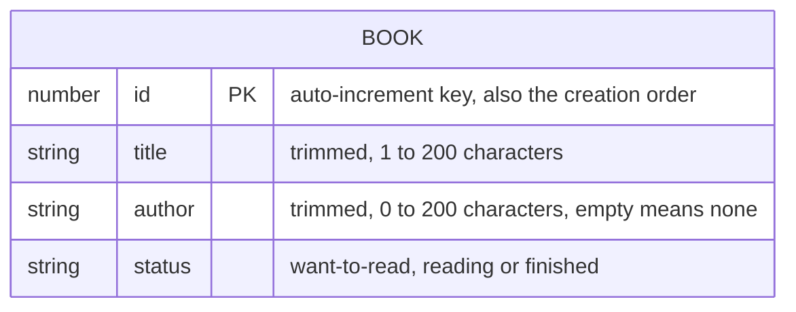

# Data model

Shelf stores one entity, the book, in the browser's IndexedDB (ADR-001, ADR-002). There is no server-side data. The storage port that reads and writes it is ARCH §7.

## 1. Entities



| Entity | Purpose | Requirements | Lifecycle (create / update / delete / retention) |
|---|---|---|---|
| Book | One book in the reader's library | FR-001 to FR-006; PRD §6 book table; A2 to A4 | **Create:** on a valid save of the add form (FR-003). **Update:** on a valid save of the edit form (FR-004). **Delete:** on confirmation (FR-005), immediately and permanently (A7). **Retention:** kept until the reader deletes the book or the browser's data for Shelf is cleared or evicted (A1, §6). |

There is no other entity. There are no settings, no stored preferences (themes follow the device), no filter or search state (FR-007 and FR-008 are Next), no session and no identifier.

## 2. Attributes and constraints

| Field | TypeScript type | Stored as | Required | Constraints | Default | Source |
|---|---|---|---|---|---|---|
| `id` | `number` (`BookId`) | IndexedDB key, from the store's key generator (`autoIncrement`) | Yes | Positive integer, unique, assigned by IndexedDB on add, never set or changed by Shelf. The key generator never decreases, so a deleted book's id is never reused while the store exists. | — | FR-001 AC-3 (tie-break), UX-004 and UX-005 (identify the page's book) |
| `title` | `string` | string | Yes | Trimmed (below), then 1 to 200 characters. Stored exactly as entered after trimming: no change of case, no Unicode normalisation, no truncation. | — | FR-003 AC-4 to AC-6, FR-004 AC-4, A4 |
| `author` | `string` | string | Yes (may be `''`) | Trimmed, then 0 to 200 characters. `''` means "no author", and the author line is left out (UX-102). | `''` | FR-003 AC-3, AC-5, A2, A4 |
| `status` | `'want-to-read' \| 'reading' \| 'finished'` | string code | Yes | Exactly one of the three codes. The labels "Want to read", "Reading" and "Finished" live in `src/books`, not in the data. | `'want-to-read'` on the add form | FR-003 AC-1, AC-2, A3 |

**Trimming and length (FR-003, the UI-SPEC UX-003 validation rules):**

- **Trimming:** uses `String.prototype.trim()`, which removes leading and trailing white space and line terminators as ECMAScript defines them.
- **Counting:** a "character" is a user-perceived character, an extended grapheme cluster, counted with `Intl.Segmenter('en', { granularity: 'grapheme' })`. An emoji or an accented letter typed as two code points counts as one, as a reader would count it.
- **Storage limit:** none. The 200-character limits are validation rules, not storage limits.
- **Single validator:** validation lives only in `src/books`. The storage adapter checks the shape of each record it reads, and a record that isn't a valid book fails the read (`failed`) instead of being dropped silently.
- **Extra fields:** a record may carry fields this build doesn't know, from a newer schema (§5). They are ignored, never removed.

**Library order (FR-001 AC-2, AC-3, A5).** Books are ordered in memory by `sortLibrary` in `src/books`:

```ts
const collator = new Intl.Collator('en', { usage: 'sort', sensitivity: 'accent' })
const compareBooks = (a: Book, b: Book) => collator.compare(a.title, b.title) || a.id - b.id
```

- **Case:** `sensitivity: 'accent'` ignores upper and lower case ("Alpha" sorts with "alpha") and keeps accents significant ("resume" and "résumé" are different titles).
- **Ties:** titles the collator treats as equal, such as identical titles or titles that differ only in case, are listed in the order they were added (smaller `id` first).
- **Literal comparison:** `numeric` is off ("Book 10" sorts before "Book 2"), punctuation and spaces count, and leading articles are not skipped ("The Hobbit" sorts under T). Other sort orders are a Later item in the PRD.
- **Locale:** English collation, because the interface is English only (A12). Collation of other scripts follows the browser's ICU data for `en`.
- **Required test cases:**
  - "beta", "Alpha", "gamma" sort as Alpha, beta, gamma (FR-001 AC-2).
  - Two books titled "Dune" with ids 3 and 7 sort as 3, then 7 (AC-3).
  - "dune" (id 9) and "Dune" (id 4) sort as 4, then 9.

## 3. Relationships and integrity rules

- **No relationships:** one entity in one object store.
- **Unique ids:** the key path guarantees them.
- **Valid records:** every stored record has the four fields with valid values. Only `addBook` and `updateBook` write records, and both take validated `BookDetails` (ARCH §7).
- **One record per transaction:** each write changes one record in one `readwrite` transaction.
- **Updates:** read the record and write it in the same transaction. A missing record returns `null` and is not re-created (a book deleted in another tab stays deleted).
- **Deletes:** idempotent: deleting a missing id succeeds and changes nothing.
- **Duplicates:** books with the same title and author are allowed (A6). Nothing is unique except `id`.

## 4. Indexes (performance-relevant only)

| Index | Query it serves | Source |
|---|---|---|
| Primary key `id` only (no secondary indexes) | `listBooks()`: `getAll()` on the store, in key order (creation order) | FR-001, NFR-003 |

A secondary index on `title` wouldn't help. IndexedDB compares string keys by code unit, so it can't produce the case-insensitive collated order of §2. At 500 books (NFR-003), reading everything once and sorting in memory is trivial. FR-007 and FR-008 (Next) will filter the same in-memory list.

## 5. Storage layout and migrations policy

**Layout, schema version 1:**

| Item | Value |
|---|---|
| Database name | `shelf` |
| Schema version (`IDBDatabase.version`) | `1`, the constant `SCHEMA_VERSION` in `app/src/storage/schema.ts` |
| Object store | `books`, `{ keyPath: 'id', autoIncrement: true }` |
| Indexes | None |
| Other stores | None |

**Upgrades.**

- **Where:** in the `upgradeneeded` handler. Steps `migrateTo1`, `migrateTo2` and so on run in order, from `oldVersion + 1` to `SCHEMA_VERSION`, inside the upgrade transaction.
- **What a step does:** creates stores and indexes, and backfills any new field for the existing records, at most a few hundred.
- **Requirements for each step:** deterministic, fast, and covered by a test that builds a database at every earlier version (fake-indexeddb) and checks the upgraded result.
- **Version 1** creates the `books` store.

**Forward-only and expand-only.**

- **What a new version may do:** add stores, indexes or optional fields.
- **What it never does:** remove or rename a store or field that an earlier release reads, or change the meaning or format of a stored value.
- **Removing something (contract)** takes two releases: one that stops reading and writing it, then one that removes it. The second release is marked as a rollback barrier in its release notes (ARCH §12).
- **Ownership:** schema changes need a DATA-MODEL version bump approved by the owner. This document is the source of truth for the schema.

**Opening, and rollback tolerance.**

1. The adapter opens `shelf` at `SCHEMA_VERSION`.
2. If that fails with `VersionError`, the stored database is newer, for example after a rollback. The adapter then opens it without a version, which never upgrades. If the `books` store exists, it uses the database as it is; expand-only guarantees that the older build can still read and write it. Otherwise it reports `newer-version`.
3. If the open is `blocked` by another tab, the adapter keeps waiting, since every Shelf tab closes its connection on `versionchange`. It reports `blocked` after 10 seconds.

**Seed data.** None: a first visit starts empty (A10). The visual-QA fixtures (ARCH §10) exist only in QA builds.

## 6. Data lifecycle, privacy and retention

- **Where the data lives:** in the IndexedDB of the reader's browser profile, for Shelf's origin. It never leaves the device: Shelf has no network code (lint rule, ADR-006 CSP). On GitHub Pages the origin is shared with the owner's other Pages sites (ARCH §13, OQ-2).
- **What is stored:** the book details only (NFR-004). No personal data, account, device or browser identifier, timestamp, usage data or analytics. Nothing in the PRD needs a creation date, and creation order comes from `id`.
- **Deletion:** removes the record immediately (A7), with no trash, tombstone or undo. The browser may keep the freed bytes on disk until its own compaction, which Shelf can't control.
- **Retention:** until the reader deletes the book or clears Shelf's site data, or the browser evicts it. Eviction covers best-effort storage under storage pressure, the end of a private window, and Safari deleting script-written storage after seven days of use without interaction with the site. A1 and R1 accept this. Shelf doesn't request persistent storage in v1 (ARCH OQ-1).
- **Backup and export:** none in v1 (PRD Later).
- **Several tabs (PRD Q9):** behaviour is undefined. Each tab works on its own in-memory copy over the same database (§3).

## 7. Change log

| Version | Date | Change | Decided by |
|---|---|---|---|
| 1.0.0 | 2026-10-29 | Initial data model: the Book entity, exact validation and order rules, the IndexedDB layout (database `shelf`, store `books`, schema version 1), and the expand-only migration and rollback policy. | Drafted by an AI agent; for owner review |
