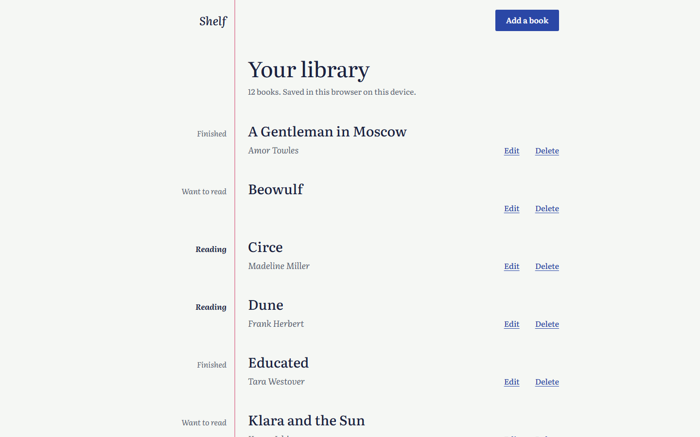

# Shelf — Design Brief (Phase 1: visual intent)

This brief sets Shelf's visual identity and intended UX. It is not an implementation spec: exact values, states and behaviour belong to the UI spec and `tokens.json` in Phase 2. The previews in [previews/v1/](previews/v1/) are part of this brief.

## 1. Chosen direction

- **Direction:** Margin notes (exploration [`docs/design/explorations/01-margin-notes/`](explorations/01-margin-notes/direction.md); all three directions are on the [contact sheet](explorations/index.html)).
- **Chosen on / by:** 2026-10-28 / dariusghiura.
- **Refinements requested:** none. The brief describes the direction as rendered after the agent's critique round (see that direction's critique log).
- **Owner inputs that shaped all three directions** (all five proposed defaults accepted, 2026-10-28): a calm, personal notebook personality; directions spanning density; light and dark themes following the device setting, with no in-app switch; no brand constraints and a type-only wordmark; one quiet line saying where the library is saved. Details in [content.md](explorations/content.md).
- **Rejected alternatives and why:** the owner gave no reasons with the choice. These are the trade-offs recorded when the directions were presented:

| Direction | What it offered | Why it was not chosen (as presented) |
|---|---|---|
| 02 Ledger ([direction](explorations/02-ledger/direction.md)) | The densest and fastest to scan (about 16 rows per desktop screen); inline editing; the most legible type. | The least personal: it reads as a tool rather than a reader's own list, against the accepted personality. A table that reflows on phones needs careful screen-reader work; its typeface has no Cyrillic. |
| 03 Bedside stack ([direction](explorations/03-bedside-stack/direction.md)) | The most memorable: cloth spines, a ribbon marker for books being read, a panel that keeps the stack in view. | The busiest and least calm. Ragged spine lengths move Edit and Delete around, the panel and bottom sheet need careful focus management, and six cloth colours add build and accessibility cost. Its typeface has no Cyrillic. |

## 2. Visual North Star

Opening Shelf should feel like opening your own notebook to the page where you keep your reading list. The page is mostly paper. Titles are set large in a calm reading serif, in blue-black ink. A single margin line runs down the page, and the things a reader would pencil in a margin (still want to read it, reading it now, finished) live there. Nothing competes with the titles: no boxes, no badges, no colour-coding. It is unhurried, quiet and plainly yours.

## 3. Personality, audience and emotional goals

- **Audience:** the PRD's casual reader. They read for pleasure, check the list on a phone in a bookshop or on the commute, and on a laptop at home.
- **Personality:** calm, personal, unfussy and literate. Not a productivity dashboard, and not a twee "cosy library" pastiche.
- **Emotional goals:**
  - *This is my list.* It looks like something the reader keeps, not something they use.
  - *I can see where I am.* What I'm reading stands out at a glance, in words.
  - *Nothing to learn.* A first visit makes the one next step obvious (FR-002).
  - *Nothing goes missing by accident.* Deleting asks first (FR-005), and the page says plainly where the library is saved (A1, R1).

## 4. Design principles

1. **The margin is the one bold idea.** *This:* statuses, the wordmark and field errors sit in the margin beside the rule ([library](previews/v1/library-desktop-light.png), [add a book](previews/v1/add-book-desktop-light.png)). *Not that:* status pills, icons or a second accent colour competing for attention.
2. **Read like a page, not a screen.** *This:* generous leading, a reading measure of about 40rem, whitespace between books. *Not that:* dividers, cards or banded rows between entries.
3. **Words carry meaning; colour never does alone.** *This:* "Reading" is written in the margin, set heavier than the other notes; an error is a sentence next to its field, plus a thicker border. *Not that:* a green dot for Finished, or a red border with no message.
4. **One thing per page.** *This:* adding and editing a book open a page of their own that reads like a new notebook entry ([add a book, phone](previews/v1/add-book-mobile-light.png)). *Not that:* modal dialogs or inline edit rows laid over the list.
5. **Quiet actions, loud content.** *This:* Edit and Delete are small underlined text links; each page has one filled button ("Add a book" on the library, "Add book" on the form). *Not that:* filled or icon buttons on every row.

## 5. Information hierarchy and density

- **Library:** page heading, then book titles, then authors (italic, muted), then the status note in the margin, then Edit and Delete. The wordmark is small. One line under the heading gives the count and where the library is saved ("12 books. Saved in this browser on this device.").
- **Order and wrapping:** books appear in the PRD's title order (FR-001, A5). Long titles and authors wrap in full and never push the status or the actions out of reach; titles in any script are shown as entered (FR-001 edge cases).
- **Add or edit a book:** page heading, then Title, Author (optional) and Reading status, then one filled "Add book" button and a quiet "Cancel" link.
- **Density:** spacious on purpose, about 6 books per desktop screen and 4 per phone screen in the previews. This is an accepted trade-off: with 500 books (NFR-003) a phone needs a long scroll until filter and search arrive (FR-007, FR-008; risk R2). Phase 2 may tighten spacing on phones within this brief's spirit, but adds no features.

## 6. Typography, colour and navigation philosophy

Intent and rationale only. The exploration's working values are recorded in its [direction.md](explorations/01-margin-notes/direction.md) as a starting point; the exact values are set in `tokens.json` in Phase 2.

- **Typography:** one family, Literata, a serif designed for long-form reading on screens (SIL Open Font License). It covers Latin, Cyrillic, Greek and Vietnamese, which serves the PRD's any-script titles. Titles are large and medium weight; authors and margin notes are italic; headings are large and light. A perfect-fourth scale (1.333), body text never below 16px, sentence case everywhere, no all caps. In the product the font is self-hosted: no requests to a font service (NFR-004, A11).
- **Colour:** a small palette named by role. Paper (a cool, slightly grey-green off-white by day; a deep blue-black page by night), ink (blue-black by day, pale by night), pencil for secondary text, one ink-blue accent for buttons, links and focus, an error red always paired with text, and a pink margin rule that is purely decorative and never carries meaning. Deliberately not cream, not terracotta.
- **Navigation:** there is no navigation bar. The wordmark returns to the library; "Add a book" is the one primary action in the header; adding and editing are pages, and Cancel returns to the library. The flow stays single and linear.

## 7. Anti-patterns (do not do)

- The generic "bookish" look: cream paper, a high-contrast display serif and a terracotta accent.
- Ruled lines across the whole page, or hairline dividers between books.
- Cards, drop shadows, gradients, or rounded chips for status.
- Status shown by colour, a dot or an icon without the word.
- All-caps labels, eyebrow labels above headings, numbered markers on a list that is not a sequence, meta strings joined with middle dots, arrows appended to button text.
- Modal dialogs or overlays for adding and editing; inline edit rows inside the list.
- Decorative motion and entrance animations.
- Sample books, illustrations or stock imagery in the empty library (A10).
- Loading fonts or anything else from a third-party service in the product (NFR-004).

## 8. Theme and responsive approach

- **Themes:** light and dark, following the device setting, with no switch in Shelf. Both themes share every layout and type decision; only colour changes. Dark is a deep blue-black page with pale ink and a muted rose margin rule.
- **Desktop (from 768px):** a margin column of about 12rem holds the wordmark, the status notes and field errors, right-aligned against the rule. Titles start just after the rule; Edit and Delete sit at the end of the author line.
- **Phone (below 768px):** the margin shrinks to a thin strip but the rule stays. Status notes move above the title, Edit and Delete move under the author, and the wordmark and "Add a book" share the top line. Field errors sit between the label and the field.
- **Narrowest width:** the layout holds at 320px with no horizontal scrolling (checked on both screens during exploration), as NFR-001 and A8 require.

## 9. Representative screen narratives

| Screen | Narrative | Previews |
|---|---|---|
| Library (FR-001; where it is saved: A1, R1) | **Purpose:** see every book and its status in title order, and reach add, edit and delete. **Primary action:** "Add a book" (the one filled button). **The eye sees first:** the page heading, then the first title; the margin notes are read as a second column of statuses, with "Reading" standing out by weight. | [desktop light](previews/v1/library-desktop-light.png), [desktop dark](previews/v1/library-desktop-dark.png), [phone light](previews/v1/library-mobile-light.png), [phone dark](previews/v1/library-mobile-dark.png) |
| Add a book, after a save with an empty title (FR-003 AC-1 and AC-4; the form FR-004 reuses) | **Purpose:** record a book with title, optional author and status. **Primary action:** "Add book"; "Cancel" returns to the library. **The eye sees first:** the heading, then the Title field with its thick error border and, in the margin beside it (above it on phones), "Enter a title. A book can't be added without one." Everything the reader entered stays in place. | [desktop light](previews/v1/add-book-desktop-light.png), [desktop dark](previews/v1/add-book-desktop-dark.png), [phone light](previews/v1/add-book-mobile-light.png), [phone dark](previews/v1/add-book-mobile-dark.png) |

## 10. Accessibility intent

- **Target:** WCAG 2.2 Level AA on every screen and state (NFR-001), plus the owner's additions: touch targets of at least 44×44px on phones, body text of at least 16px, and reduced motion respected. The direction uses no motion at all.
- **Contrast** (from the exploration's working colours): light theme text 14.6:1, secondary text 6.3:1, accent 7.6:1, error 7.0:1, field borders 5.5:1; dark theme text 14.3:1, secondary 7.9:1, accent 9.1:1, error 8.8:1, field borders 5.7:1. The margin rule is decorative.
- **Structure:** header and main landmarks, one `h1` per page, a skip link, the library as a list. Each book's status is real text, announced with its book; every Edit and Delete names its book ("Edit Dune", "Delete Dune").
- **Forms:** visible labels; the status choice is a labelled group of radio buttons in 44px rows; errors are text tied to their field, marked as invalid, with an "Error:" prefix for screen readers. After a failed save, focus goes to the first field with an error.
- **Focus:** a clearly visible 3px outline in the accent colour. The preview renders cannot show it (the headless capture never focuses the page), so Phase 2 must verify focus states in the running app.

## 11. Open questions

| Question | Proposed default | Decide in |
|---|---|---|
| How does the delete confirmation (FR-005) look in a "one thing per page" design: a confirmation page, or a dialog over the list? | A small confirmation step in the same page style rather than an overlay, unless Phase 2 finds it awkward on phones. | Phase 2 (UI spec), owner review |
| The empty library (FR-002) and the save failure (FR-006 AC-3) were not rendered. | Use the copy in [content.md](explorations/content.md), in this brief's style: the empty library is a heading, one sentence and the "Add a book" button, with nothing in the margin. | Phase 2 (UI spec) |
| Is the spacious phone density acceptable for large libraries before FR-007 and FR-008 (R2)? | Keep it, as rendered. | Owner review of this brief |
| After saving a book, where does the reader land? | Back on the library, with the saved book in view at its place in title order. | Phase 2 (UI spec) |
| Which Literata weights and styles are self-hosted? | Regular and italic, with the variable weight axis. | Phase 2 (tokens) and architecture |

## 12. Decisions and change log

| Version | Date | Change | Decided by |
|---|---|---|---|
| 1.0.0 | 2026-10-28 | Initial brief. The owner chose Direction 01 Margin notes from three rendered directions (01 Margin notes, 02 Ledger, 03 Bedside stack), with no refinements. Phase 1 inputs: all five proposed defaults accepted. Previews: `previews/v1/`. | dariusghiura (choice); drafted by an AI agent |
| 1.0.1 | 2026-10-29 | `based_on` refreshed to PRD 1.1.0 ([change request #6](https://github.com/dariusghiura/sdlc-pilot-shelf/issues/6) added FR-006 AC-4). Nothing else changes: the read-failure page (UI-SPEC UX-006) follows this brief as written. The refresh is needed because the kit compares MAJOR.MINOR, so a brief based on PRD 1.0.0 would be stale against 1.1.0 and fail every downstream gate. | Drafted by an AI agent; for owner review |
